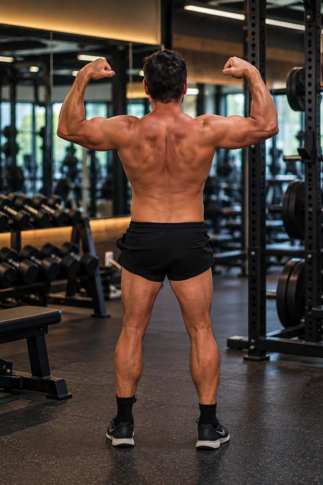

# Noah's Weekly Lifting Routine

A simple, mobile-first static site that shares my 6-day push / pull / shoulders / legs / arms / core split, with a "start here" section for beginners.

Plain HTML, CSS, and a little vanilla JS. No build step, no frameworks, no analytics or trackers.

## Files

| File | What it is |
| --- | --- |
| `index.html` | The whole page: hero, weekly cards, 21s, training notes, beginners, sources, credits, disclaimer |
| `style.css` | Styles, with light/dark mode via `prefers-color-scheme` |
| `script.js` | Highlights and opens today's card; opens a card when you jump to it |
| `assets/` | Self-hosted, compressed WebP images and the favicon |
| `CREDITS.md` | Photographer, source URL, and license for every image |

All paths are relative, so the site works at `https://<username>.github.io/<repo>/`.

## Deploy to GitHub Pages

1. Create a public GitHub repo.
2. Push the files to `main`.
3. Settings > Pages > Deploy from branch > `main` / root.
4. Site goes live at `https://<username>.github.io/<repo>/`.

For this repo that's `https://noahjanderson.github.io/noah-anderson-workout-plan/`.

## Preview locally

```sh
python3 -m http.server 8000
# open http://localhost:8000
```

## Adding my photo

The hero currently shows a dark gradient placeholder. To swap in the real photo:

1. Crop to 4:5 portrait (e.g. 800x1000) and convert/compress to WebP, under ~300 KB:
   ```sh
   convert noah.jpg -resize 800x1000^ -gravity center -extent 800x1000 -quality 80 assets/noah.webp
   ```
2. In `index.html`, replace the `<div class="hero__placeholder" ...>...</div>` block with:
   ```html
   
   ```
   (Adjust the alt text to describe the actual photo.) The angled orange frame is already styled.

## Editing the routine

Each day is an `<article class="day">` in `index.html`. Add or remove `<li>` items in its `<ul class="ex">` list. A short cue under an exercise goes in `<span class="cue">...</span>`.
